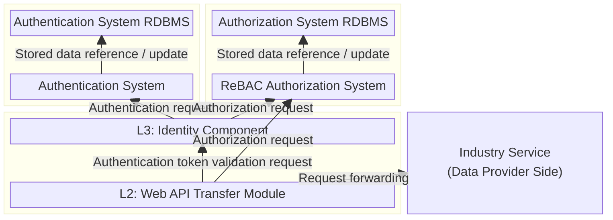
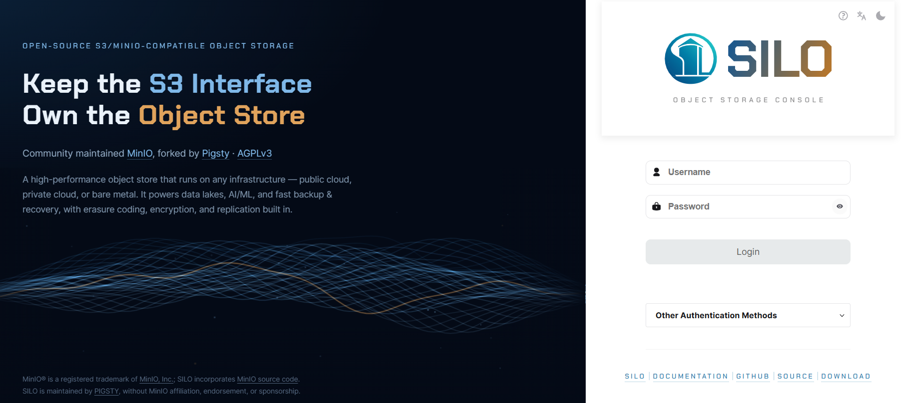
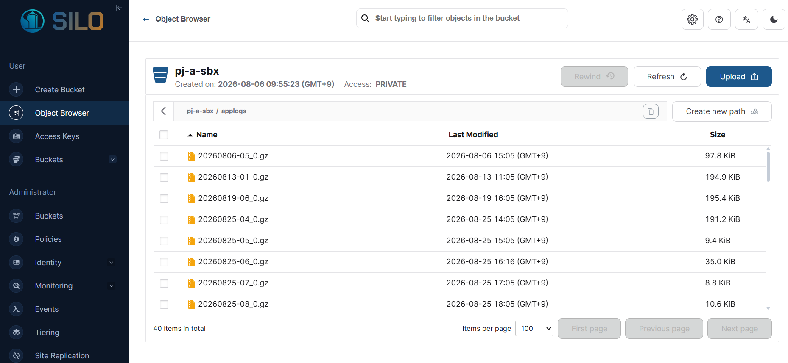
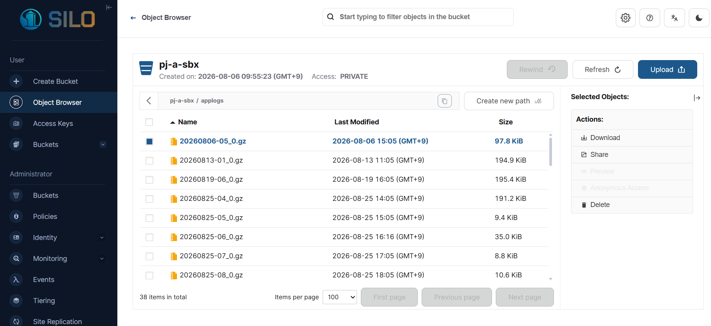

# ODS SDK for Onboarding Deployment Definition Files (Helm Chart)

## Overview

This repository provides deployment definition files for Helm Charts as one of the SDK for Onboarding provided by Open Data Spaces (hereinafter referred to as "ODS").
By using these definition files, users can easily deploy and use the ODS components in their own Kubernetes environments.

## Prerequisites

The software published in this repository has been verified to operate in the following environment:

- Machine specifications: Core i7-1265U, 16 GiB memory, 500 GB SSD
- OS: Windows 11 + WSL2 (Ubuntu 24.04)
- Docker:
  - Client: 28.1.1-rd  
  - Server: 27.3.1  
  - Compose: 2.37.1
- Helm: v4.2.3+g43e8b7f
- kubectl client: v1.29.0
- kind: v0.22.0


## Repository Structure

The directory structure of this repository is as follows:

| File / Directory | Description |
| ---------------- | ----------- |
| Chart.yaml | Top-level deployment definition that aggregates component definitions and allows them to be started and stopped together |
| charts/l2 | Directory containing deployment definitions for the L2 (Transaction Layer) component: Web API Transfer Module |
| charts/l3 | Directory containing deployment definitions for the L3 (Identity Layer) component: Identity Component |
| charts/logging | Directory containing deployment definitions for the logging service |
| charts/mockserver | Directory containing deployment definitions for the mock server used for verification |
| charts/payment | Directory containing deployment definitions for the Clearing and Billing/Payment Service |
| setup | Collection of scripts that simplify and automate the setup procedures |

## Setup Procedure

### System Architecture Diagram

The components and services deployed by this SDK are shown below.  
Rectangles represent components or services, and arrows represent dependency relationships between them.



In this SDK, PostgreSQL is used as the RDBMS, Keycloak is used as the authentication system, and OpenFGA is used as the ReBAC authorization system.
Hereafter, the Identity Component and Web API Transfer Module may be referred to simply as L3 and L2, respectively.

Unless otherwise specified, all commands are assumed to be executed from the root directory created by `git clone` of this repository.

### Startup and Shutdown

#### Startup

```bash
$ helm install ods .
```

#### Shutdown

```
$ helm uninstall ods
```

### Initial Configuration of Each Component

The initial setup procedures for each component are described below.

#### Preliminary Steps — Pulling Container Images for Each Component

When deploying the components using Helm Charts, the required container images must be loaded into the Kubernetes environment in advance.
This Helm Chart assumes the same images that are built using the Docker Compose–based deployment definitions available in the following repository: https://github.com/open-dataspaces/SDK-docker-compose  

To build the images, first clone the Docker Compose repository and complete the setup steps described in [Initial Setup of Each Component](https://github.com/open-dataspaces/SDK-docker-compose/blob/main/README_en.md#initial-setup-of-each-component) section of the repository. Then, run the following commands from the root directory of the Docker Compose repository.

```
$ docker build . -f ./l3/Dockerfile -t openfga-authzen:latest
$ docker build . -f ./l3/Dockerfile-local -t l3-app:latest
$ docker build . -f ./l2/Dockerfile -t ods/dp-http:latest
$ docker build . -f ./logging/Dockerfile -t fluentd:1.19.1
$ docker build . -f ./payment/Dockerfile -t payment-app:latest
$ docker build . -f ./payment/Dockerfile.checkl2log -t ods-payment-checkl2log:latest
```

As an example of loading the images built using the above steps into a Kubernetes environment, the following shows an example using **kind**.  
In this example, the cluster name is set to `ods`, and the namespace is `default`.

```
$ kind load docker-image ods/dp-http:latest openfga-authzen:latest l3-app:latest payment-app:latest fluentd:1.19.1 ods-payment-checkl2log:latest --name ods
```

Once the environment preparation is complete, start all services using the `Chart.yaml` file located at the top level of this repository.

```
$ helm install ods .
```

If the following output is displayed, the deployment has been completed successfully.

```
NAME: ods
LAST DEPLOYED: Tue Mar 17 16:32:51 2026
NAMESPACE: default
STATUS: deployed
REVISION: 1
TEST SUITE: None
```

From this state, proceed with the initial configuration for each component.

#### L3: Identity Component

For L3, the initial setup described in [Service Startup](https://github.com/open-dataspaces/L3-identity-component/blob/main/README_en.md#1-service-startup) and the [Reference Implementation Tutorial](https://github.com/open-dataspaces/L3-identity-component/blob/main/docs/tutorials/tutorials_en.md) is required.

This guide provides a script that performs the SDK-specific configuration for "[1-1. Loading Tutorial Data](https://github.com/open-dataspaces/L3-identity-component/blob/main/docs/tutorials/tutorials_en.md#1-1-loading-tutorial-data)" described in the Reference Implementation Tutorial. The procedure for executing the script is shown below.

```
$ cd setup
$ bash setup_l3.sh
$ cd -
$ helm upgrade ods .
```

This script creates and configures Keycloak realms, clients for API authorization, OpenFGA stores, authorization models and tuples, as well as system API keys.

If you need to change these settings, edit `setup/setup_l3.sh` before executing the script.

In addition, the business operator client IDs should be created as described later in "Data Configuration for Starting Operations".

Next, execute the following commands to create the OpenFGA store and authorization model, and apply the generated values to `charts/l2/values.yaml`.

```
$ cd setup
$ bash setup_l2.sh
$ cd -
```

The store name created in OpenFGA by the above procedure is "ODS-USER-STORE".  
If you need to change this value, edit `setup/openfga/51-create-user-store.json`.

#### L2: Web API Transfer Module

By completing the above steps, all settings required to start L2 have already been reflected in `charts/l2/values.yaml`.  
Therefore, no additional configuration is required.


## Operations Setup

### Preliminary Steps

#### Port Forwarding

In this procedure, port forwarding is configured for each service running on Kubernetes to perform operation and verification.

```
$ kubectl port-forward svc/ods-l3-l3-app 8080:8080
$ kubectl port-forward svc/ods-l3-keycloak 8082:8082
$ kubectl port-forward svc/ods-l3-openfga 8083:8083

$ kubectl port-forward svc/ods-l2-gateway 8090:8090
```

#### Changing the Access Token Lifetime

The access token lifetime is set to 60 seconds by default.  
If this duration is too short, it can be extended as needed.
The following example shows how to extend the access token lifetime to 300 seconds.

```
$ ADMIN_ACCESS_TOKEN=$(
  curl -s -X POST "http://localhost:8082/realms/master/protocol/openid-connect/token" \
    -H "Content-Type: application/x-www-form-urlencoded" \
    -d "grant_type=password" \
    -d "client_id=admin-cli" \
    -d "username=admin" \
    -d "password=password" | jq -r .access_token
)

$ curl -X PUT "http://localhost:8082/admin/realms/master" \
    -H "Authorization: Bearer ${ADMIN_ACCESS_TOKEN}" \
    -H "Content-Type: application/json" \
    -d '{"accessTokenLifespan": 300}'
```

### Data Configuration for Starting Operations

Follow the procedures described in the [Reference Implementation Tutorial 2-1. Creation of Authentication Information (Operator Information / Individual Users / Client IDs)](https://github.com/open-dataspaces/L3-identity-component/blob/main/docs/tutorials/tutorials_en.md#2-1-creation-of-authentication-information-operator-information--individual-users--client-ids) and complete the steps from business information registration through [2-1-5. Retrieving the Operator Client Secret](https://github.com/open-dataspaces/L3-identity-component/blob/main/docs/tutorials/tutorials_en.md#2-1-5-retrieving-the-operator-client-secret).

For this procedure, specify `localhost:8080` as the destination host, set `$SYSTEM_CLIENT_SECRET` to the value defined in `charts/l3/values.yaml` shown below, set `API-Key` to `API-Key-Sample`, and specify `system-auth-sample` as the `client_id`.

```
l3KeycloakIntrospectClientSecret
```

### Environment Configuration Between Components

To enable L2 to integrate with L3, configure the URL of the authentication system (Keycloak) in the following parameter in `charts/l2/values.yaml`.
In the Helm Chart provided by this SDK, the service URL to be used when L3 is running in the same cluster is already configured as the Keycloak URL.
If the URL of L3 is changed for any reason, update the value below accordingly.

```
keycloakUrl
```

### Industry Service Integration

The following describes the configuration required to integrate with industry services on the data provider side.
In this procedure, an example is shown that allows communication with a mock server prepared as a sample industry service.

#### L3: Identity Component

##### Registering Tuples in the OpenFGA Store

Execute the following command to register authorization tuples for the industry service in the OpenFGA store.
Specify the following values for the variables used in the command.

| Variable | Value |
| --- | --- |
| `$USER_STORE_ID` | Value of `fgaStoreId` configured in `charts/l2/values.yaml` |

```
$ curl -i -X POST \
  http://localhost:8083/stores/$USER_STORE_ID/write \
  -H "Content-Type: application/json" \
  -d '{
  "writes": {
    "tuple_keys": [
      { "user": "group:endpoint-test-get#member",    "relation": "can_access", "object": "endpoint:test.get" },
      { "user": "group:endpoint-test-post#member",   "relation": "can_access", "object": "endpoint:test.post" },
      { "user": "group:endpoint-test-put#member",    "relation": "can_access", "object": "endpoint:test.put" },
      { "user": "group:endpoint-test-delete#member", "relation": "can_access", "object": "endpoint:test.delete" }
    ],
    "on_duplicate": "ignore"
  }
}'
```

In this example, authorization groups are created for each CRUD operation on the endpoints exposed by the industry service.
For example, the first entry in `tuple_keys` means that users who are members of the group `endpoint-test-get` have a relationship (`can_access`) that allows them to access the target endpoint `test.get`.
Here, the endpoint `test.get` specified in the object corresponds to the route defined later in the L2 configuration, which represents the request forwarding destination to the industry service.
Similarly, the second through fourth entries indicate that users who are members of the groups `endpoint-test-post`, `endpoint-test-put`, and `endpoint-test-delete` can access the respective endpoints `test.post`, `test.put`, and `test.delete`.

##### Granting Authorization to an Operator

Next, execute the following command to register the operator’s authorization settings for the industry service in the OpenFGA store.
Specify the following values for the variables used in the command.

| Variable | Value |
| --- | --- |
| `$USER_STORE_ID` | Value of `fgaStoreId` configured in `charts/l2/values.yaml` |
| `$USER_MODEL_ID` | Value of `fgaModelId` configured in `charts/l2/values.yaml` |
| `$OPERATOR_ID` | `operator_id` issued when registering the operator information (described above) |

```
$ curl -i -X POST "http://localhost:8083/stores/$USER_STORE_ID/write" \
      -H "Content-Type: application/json" \
      -d '{
        "authorization_model_id": "'$USER_MODEL_ID'",
        "writes": {
          "tuple_keys": [
            {
              "user": "user:'$OPERATOR_ID'",
              "relation": "member",
              "object": "group:endpoint-test-post"
            }
          ]
        }
      }'
```

In this step, the operator is added to a group that has permission to send **POST** requests to the industry service.
To change the permissions to be granted, replace the value of the `object` property with the corresponding group and execute the command again.

#### L2: Web API Transfer Module

For L2, it is necessary to reflect information in `charts/l2/values.yaml` (the OpenFGA store ID and authorization model ID), apply the changes, and configure routing.

Regarding the configuration update, if `setup/setup_l2.sh` has been executed as part of the initial setup procedure, `charts/l2/values.yaml` is automatically updated and no additional action is required.

If the OpenFGA store and authorization model were created without executing `setup/setup_l2.sh`, specify the IDs of the created store and authorization model in the following parameters in `charts/l2/values.yaml`.

```
fgaStoreId
fgaModelId
```

Restart L2 using the following command to apply the configuration changes.

```
$ helm upgrade ods .
```

Next, configure routing to forward requests to the industry service.
In this example, a route configuration is shown that allows POST requests only to a mock server.Execute the following command.

```
$ curl -X POST\
    -H "Content-Type: application/json"\
    -H "X-API-Key: your-secret-management-api-key"\
    -d '{
    "id": "route01",
    "uri": "http://mockoon.default.svc.cluster.local:4011/test",
    "predicates": [{
        "name": "Path",
        "args": {
        "_genkey_0": "/test**"
         }
     },
      { 
        "name": "Method",
        "args": { 
        "_genkey_0": "POST"
         }
      }],
    "metadata": {
      "endpointId": "test.post"
     }    
    }'\
    http://localhost:8090/actuator/gateway/routes/route01
```

By executing the above command, requests sent by data consumers to
`http://(L2 FQDN)/test` are forwarded to the industry service URL specified in the `"uri"` field
(in this example, `http://mockoon.default.svc.cluster.local:4011/test`).

The value `"test.post"` specified as `"endpointId"` in the metadata corresponds to the endpoint
`"endpoint:test.post"` that was registered as an object in OpenFGA.

As a result, users who belong to the OpenFGA group `group:endpoint-test-post`
are allowed to send POST requests to this URL.


When registering a route, it is also possible to modify the exposed path,
add or remove headers, and perform other customizations.

Refer to the example below and add any required settings to the request payload shown above.


```
    "filters": [
    {
        "name": "RewritePath",
        "args": {
        "_genkey_0": "/public/path/(?<segment>.*)",
        "_genkey_1": "/${segment}"
         }
    },
    {
        "name": "AddRequestHeader",
        "args": {
            "name": "Custom header name used by the industry service",
            "value": "Custom value"
        }
    },
    {
        "name": "RemoveRequestHeader",
        "args": {
        "name": "Header name not required by the industry service"
         }
    }],
```

#### Data Consumer

Data consumers must include the following HTTP headers in their requests.
The required headers for accessing the industry service are as follows.

| Header Name | Description |
| ---: | --- |
| API-Key | API key issued by this service |
| Authorization | Access token (JWT format) issued by L3 (Identity Component) |
| X-TrackingId | Log output field for traceability management (UUID format) |
| X-ODS-xxx | Fields subject to logging. Specify `xxx` with a string designated by the service provider (e.g., `X-ODS-UserId`) |

#### Data Provider

Data providers start the industry service that corresponds to the configured routing settings.
In this procedure, a mock server is used as an example.If all services are started together, this mock server is already running.

### Data Exchange

The following describes the procedure for performing data exchange between consumers and providers using the components deployed by the deployment definition files in this repository, as well as the industry services integrated with them.

1. Obtain an Access Token
   Execute [L3 Reference Implementation Tutorial 2-2-1. Obtaining an Access Token (Operator Client ID Authentication)](https://github.com/open-dataspaces/L3-identity-component/blob/main/docs/tutorials/tutorials_en.md#2-2-1-obtaining-an-access-token-operator-client-id-authentication) to obtain an access token.
   Specify `localhost:8080` as the destination host and set `API-Key` to `API-Key-Sample`.

2. Data Access  
   Perform data access using the obtained access token.

   To send a POST request to the industry service configured in the route registration, execute the following command.

    ```
    $ curl -X POST "http://localhost:8090/test" \
      -H 'API-Key: 2dfd3409-ce01-4451-96fa-7e10c9681422y' \
      -H "Authorization: Bearer $ACCESS_TOKEN" \
      -H 'X-ODS-UserId: 112233' \
      -H "Content-Type: application/json" \
      -H "Prefer: return=representation" \
      -d '{"userid":112233}' | jq .
    ```
    A response similar to the following is returned from the `/test` endpoint.
    ```
    {
      "message": "Request successfully delivered!"
    }
    ```

### Clearing and Billing/Payment

The Clearing and Billing/Payment Service provides functions to calculate and present payment and billing amounts for both consumers and providers based on the usage fee models registered by data providers and the history of data exchanges conducted between them.

In addition, the service integrates with external services to perform actual payment processing.
Transaction records are registered by both consumers and providers, and are cross-checked with log information collected from the Web API Transfer Module to ensure validity.

For more details, refer to the documentation of the
[Clearing and Billing/Payment Service](https://github.com/open-dataspaces/DCS-Payment).


#### Preparation

##### Creating Business Operator Clients

The Clearing and Billing/Payment Service requires two business operator clients: one for the data provider and one for the data consumer.

Follow the procedures described in [Reference Implementation Tutorial 2-1. Creation of Authentication Information (Operator Information / Individual Users / Client IDs)](https://github.com/open-dataspaces/L3-identity-component/blob/main/docs/tutorials/tutorials_en.md#2-1-creation-of-authentication-information-operator-information--individual-users--client-ids) and complete the steps from business information registration through [2-1-5. Retrieving the Operator Client Secret](https://github.com/open-dataspaces/L3-identity-component/blob/main/docs/tutorials/tutorials_en.md#2-1-5-retrieving-the-operator-client-secret) to create business operator clients for both the data provider and the data consumer.

In the following procedures, the client IDs of the created data provider and data consumer will be referred to as `PROVIDER_ID` and `CONSUMER_ID`, respectively.

##### Authorization Configuration

To verify the operation of the Clearing and Billing/Payment Service, it is necessary to exchange data with the industry service through L2. Therefore, both L3 and L2 require authorization settings and route configuration.

This section provides an example of authorization control and route configuration.

##### Registering Tuples in OpenFGA

Run the following command to register authorization tuples for the industry service in the OpenFGA store.

Specify the following values for the variables used in the command.

If you have already completed the "Registering Tuples in the OpenFGA Store" procedure described in the Operations Setup section of this SDK, you can skip this step.

| Variable | Value |
| -------- | ----- |
| `$USER_STORE_ID` | Value of `FGA_STORE_ID` in `charts/l2/values.yaml` |

```
$ curl -i -X POST http://localhost:8083/stores/$USER_STORE_ID/write \
  -H "Content-Type: application/json" \
  -d '{
  "writes": {
    "tuple_keys": [
      {
        "user": "group:endpoint-test-get#member",
        "relation": "can_access",
        "object": "endpoint:test.get"
      }
    ],
    "on_duplicate": "ignore"
  }
}'
```

##### Granting Authorization to Business Operators

Next, run the following command to register authorization settings for the business operators in the OpenFGA store so that they can access the industry service.

Specify the following values for the variables used in the command.

| Variable | Value |
| -------- | ----- |
| `$USER_STORE_ID` | Value of `fgaStoreId` in `charts/l2/values.yaml` |
| `$USER_MODEL_ID` | Value of `fgaModelId` in `charts/l2/values.yaml` |
| `$PROVIDER_ID` | `operator_id` of the data provider issued during the business operator client creation procedure described above |
| `$CONSUMER_ID` | `operator_id` of the data consumer issued during the business operator client creation procedure described above |

```
$ curl -i -X POST http://localhost:8083/stores/$USER_STORE_ID/write \
  -H "Content-Type: application/json" \
  -d '{
    "authorization_model_id": "'$USER_MODEL_ID'",
    "writes": {
      "tuple_keys": [
        { "user": "user:'$PROVIDER_ID'", "relation": "member", "object": "group:endpoint-test-get" },
        { "user": "user:'$CONSUMER_ID'", "relation": "member", "object": "group:endpoint-test-get" }
        ],
      "on_duplicate": "ignore"
    }
  }'
```

##### Configuring Data Access Routes

Referring to "Integration with Industry Services - L2: Web API Transfer Module", configure routes so that communication logs are recorded by L2.

In this example, only GET requests to the mock server are permitted.

Run the following command.

```
$ curl -X POST\
    -H "Content-Type: application/json"\
    -H "X-API-Key: your-secret-management-api-key"\
    -d '{
    "id": "route02",
    "uri": "http://mockoon:4011/test",
    "predicates": [{
        "name": "Path",
        "args": {
        "_genkey_0": "/test**"
         }
     },
      {
        "name": "Method",
        "args": {
        "_genkey_0": "GET"
         }
      }],
    "metadata": {
      "endpointId": "test.get"
     }
    }'\
    http://localhost:8090/actuator/gateway/routes/route02
```

#### Clearing and Payment Processing

1. Run the database migration for the Clearing and Billing/Payment Service.

```
# Get the Pod name
$ kubectl get pods -l app=ods-payment-payment-app
 
# Connect to the Pod and run the migration
$ cd ./setup
$ kubectl exec -it <pod-name> -- alembic -c migrations/alembic.ini upgrade head
...

INFO  [alembic.runtime.migration] Context impl PostgresqlImpl.
INFO  [alembic.runtime.migration] Will assume transactional DDL.
INFO  [alembic.runtime.migration] Running upgrade  -> 001_initial, Initial tables - 全テーブル統合版
$ cd -
```

2. Set the same value as `l3KeycloakIntrospectClientSecret` defined in `chart/l3/values.yaml`
   for the following parameter in `charts/payment/values.yaml`, then restart the
   Clearing and Billing/Payment Service to apply the changes.

   For simplicity, the authorization feature of the Clearing and Billing/Payment Service is disabled in this example.
   In a production system, configure the authorization feature appropriately by referring to the [Clearing and Billing/Payment Service documentation](https://github.com/open-dataspaces/DCS-Payment).

```
paymentL3ClientSecret
```

```
$ helm upgrade ods .
```

3. Register a dummy payment service for verification purposes in advance, along with the associated data provider and data consumer, in the database.

   Also, store the ID of the registered service in a variable for later use.
```
# Retrieve the Pod name
$ kubectl get pods -l app=ods-payment-payment-db

# Register the service ID
$ PAYMENT_SERVICE_ID=$(uuidgen -t)

$ kubectl exec -it <ods-payment-payment-db name> -c payment-db -- psql fastapi_db -U postgres -c "INSERT INTO payment_services VALUES ('$PAYMENT_SERVICE_ID', 'test_service', 'http://example.com/')"

$ kubectl exec -it <ods-payment-payment-db name> -c payment-db -- psql fastapi_db -U postgres -c 'SELECT * FROM payment_services'
          payment_service_id          | payment_service_name | payment_service_url |          created_at           |          updated_at
--------------------------------------+----------------------+---------------------+-------------------------------+-------------------------------
 e020a70e-c9be-11f1-8000-5847ca798141 | test_service         | http://example.com/ | 2026-10-17 02:08:57.675444+00 | 2026-10-17 02:08:57.675444+00
(1 row)

$ PAYMENT_SERVICE_USER_ID=$(uuidgen -t)

$ kubectl exec -it <ods-payment-payment-db name> -c payment-db -- psql fastapi_db -U postgres -c "INSERT INTO payment_service_user_registrations (payment_service_user_id, payment_service_id, consumer_id, provider_id) VALUES ('$PAYMENT_SERVICE_USER_ID', '$PAYMENT_SERVICE_ID', '$CONSUMER_ID', '$PROVIDER_ID')"
INSERT 0 1

$ kubectl exec -it <ods-payment-payment-db name> -c payment-db -- psql fastapi_db -U postgres -c '\x' -c 'SELECT * FROM payment_service_user_registrations'
Expanded display is on.
-[ RECORD 1 ]-----------+-------------------------------------
payment_service_user_id | 07c9ad28-c9bf-11f1-8000-5847ca798141
payment_service_id      | e020a70e-c9be-11f1-8000-5847ca798141
consumer_id             | 67802e2d-eb7e-458c-9746-54d764a83790
provider_id             | 22de1c3b-0e87-44d8-8ee4-9b8b427e9305
company_name            |
department              |
customer_name           |
zip_code                |
address                 |
tel_no                  |
external_buyer_id       |
external_data           |
created_at              | 2026-10-17 02:09:39.707863+00
updated_at              | 2026-10-17 02:09:39.707863+00
```

4. Obtain an access token by executing [L3 Reference Implementation Tutorial 2-2-1. Obtaining an Access Token (Operator Client ID Authentication)](https://github.com/open-dataspaces/L3-identity-component/blob/main/docs/tutorials/tutorials_en.md#2-2-1-obtaining-an-access-token-operator-client-id-authentication).

   Specify `localhost:8080` as the destination host and set `API-Key` to `API-Key-Sample`.

   For the purposes of the following examples, the data provider's access token is represented by `PROVIDER_ACCESS_TOKEN`, and the data consumer's access token is represented by `CONSUMER_ACCESS_TOKEN`.

##### Registering a Usage Fee Model (Provider)

Send the following request to register a usage fee model with the Clearing and Billing/Payment Service.

Note that port forwarding is also performed in this procedure.

```
$ kubectl port-forward svc/ods-payment-payment-app 8001:8001
```

```
$ curl -X POST \
  -H "Content-Type: application/json" \
  -H "Authorization: Bearer $PROVIDER_ACCESS_TOKEN" \
  -H "X-TrackingId: $(uuidgen -t)" \
  -H "x-payment-api-key: payment-api-key" \
  -H "Accept-Language: ja-JP" \
  -H "User-Agent: payment-test" \
  -d '{
    "valid_from": "2026-07-01T00:00:00Z",
    "provider_id": "'"$PROVIDER_ID"'",
    "consumer_id": "'"$CONSUMER_ID"'",
    "data_id": "'"I0101"'",
    "payment_service_id": "'"$PAYMENT_SERVICE_ID"'",
    "fee_model_name": "Pricing Model",
    "price": "1000.00",
    "tax_classification": "taxable",
    "tax_rate": "0.10",
    "is_active": true,
    "version": 1
  }' \
  localhost:8001/api/v1/fee-model
```

If the operation is successful, a response similar to the following is returned.

```
{
  "created_at": "2026-10-17T02:12:35.591461Z",
  "updated_at": "2026-10-17T02:12:35.591461Z",
  "valid_from": "2026-07-01T00:00:00Z",
  "is_active": true,
  "version": 1,
  "storage_type": "provider_env",
  "storage_key": "",
  "valid_to": null,
  "provider_id": "22de1c3b-0e87-44d8-8ee4-9b8b427e9305",
  "consumer_id": "67802e2d-eb7e-458c-9746-54d764a83790",
  "data_id": "I0101",
  "payment_service_id": "e020a70e-c9be-11f1-8000-5847ca798141",
  "fee_model_name": "Pricing Model",
  "price": "1000.00",
  "tax_classification": "taxable",
  "tax_rate": "0.1000",
  "fee_model_id": "c487c62c-7c05-4da1-a72b-22462c3cb2f1"
}
```

#### Retrieving the Usage Fee Model List (Provider)

The registered usage fee models can be confirmed using the following request.

```
$ curl -s \
  -H "Content-Type: application/json" \
  -H "Authorization: Bearer $PROVIDER_ACCESS_TOKEN" \
  -H "X-TrackingId: $(uuidgen -t)" \
  -H "x-payment-api-key: payment-api-key" \
  localhost:8001/api/v1/fee-model
```

If the operation is successful, a response similar to the following is returned.

```
{
  "models": [
    {
      "created_at": "2026-10-17T02:12:35.591461Z",
      "updated_at": "2026-10-17T02:12:35.591461Z",
      "valid_from": "2026-07-01T00:00:00Z",
      "is_active": true,
      "version": 1,
      "storage_type": "provider_env",
      "storage_key": "",
      "valid_to": null,
      "provider_id": "22de1c3b-0e87-44d8-8ee4-9b8b427e9305",
      "consumer_id": "67802e2d-eb7e-458c-9746-54d764a83790",
      "data_id": "I0101",
      "payment_service_id": "e020a70e-c9be-11f1-8000-5847ca798141",
      "fee_model_name": "Pricing Model",
      "price": "1000.00",
      "tax_classification": "taxable",
      "tax_rate": "0.1000",
      "fee_model_id": "c487c62c-7c05-4da1-a72b-22462c3cb2f1"
    }
  ]
}
```

##### Executing Data Exchange (Data Consumer)

Perform data exchange using the route configured during the prerequisite steps.

The Clearing and Billing/Payment Service identifies each data exchange using the value of the `X-TrackingId` header included in the request.
In this example, a dummy value is used.

Because this ID is required in subsequent steps, save it as an environment variable.

Run the following command.

```
$ export TRACKING_ID=$(uuidgen -t)
$ curl -X GET "http://localhost:8090/test" \
  -H 'API-Key: 2dfd3409-ce01-4451-96fa-7e10c9681422y' \
  -H "Authorization: Bearer $CONSUMER_ACCESS_TOKEN" \
  -H "X-TrackingId: $TRACKING_ID" \
  -H 'X-ODS-UserId: 112233' \
  -H "Content-Type: application/json" \
  -H "Prefer: return=representation"
```

If a response similar to the following is returned from the `/test` endpoint, the data exchange has completed successfully.

```
{
  "message": "Request successfully delivered!"
}
```

##### Registering Data Exchange Status (Consumer and Provider)

When the data exchange is completed, both the data consumer and the data provider must register the transaction record with the Clearing and Billing/Payment Service.

The target data exchange is identified by the value of the `X-TrackingId` header used during the data exchange.

##### Data Provider Execution

```
$ curl -X POST \
  -H "Content-Type: application/json" \
  -H "Authorization: Bearer $PROVIDER_ACCESS_TOKEN" \
  -H "X-TrackingId: $(uuidgen -t)" \
  -H "x-payment-api-key: payment-api-key" \
  -H "Accept-Language: ja-JP" \
  -H "User-Agent: payment-test" \
  -d '{
    "tracking_id": "'"$TRACKING_ID"'",
    "provider_id": "'"$PROVIDER_ID"'",
    "consumer_id": "'"$CONSUMER_ID"'",
    "data_id_list": ["I0101"],
    "completed_at": "'$(date -Iseconds -u)'",
    "status": "completed"
  }' \
  localhost:8001/api/v1/data-exchange/status
```

If the registration is successful, the following response is returned.

```
{"status":"success","detail":"Data exchange status registered"}
```

##### Data Consumer Execution

```
$ curl -X POST \
  -H "Content-Type: application/json" \
  -H "Authorization: Bearer $CONSUMER_ACCESS_TOKEN" \
  -H "X-TrackingId: $(uuidgen -t)" \
  -H "x-payment-api-key: payment-api-key" \
  -H "Accept-Language: ja-JP" \
  -H "User-Agent: payment-test" \
  -d '{
    "tracking_id": "'"$TRACKING_ID"'",
    "provider_id": "'"$PROVIDER_ID"'",
    "consumer_id": "'"$CONSUMER_ID"'",
    "data_id_list": ["I0101"],
    "completed_at": "'$(date -Iseconds -u)'",
    "status": "completed"
  }' \
  localhost:8001/api/v1/data-exchange/status
```

If the registration is successful, the following response is returned.

```
{"status":"success","detail":"Data exchange completed for tracking_id: 9080da56-c9bf-11f1-8000-5847ca798141"}
```

##### L2 Transaction Check

The Clearing and Billing/Payment Service verifies transaction consistency by retrieving L2 logs from an AWS S3 bucket.

In this SDK, L2 logs are stored in the Silo bucket every hour. To perform the verification immediately, restart Fluentd to force log rotation.

The procedure is as follows.

```
$ kubectl rollout restart deploy/ods-logging-fluentd
```

This SDK defines the consistency check as a CronJob for periodic execution, as described in the [documentation](https://github.com/open-dataspaces/DCS-Payment/blob/v1.0.0/cronjob/docs/feature-spec-checkl2log.md).

This section provides an example of executing the L2 Transaction Check once against a Silo bucket that is compatible with Amazon S3.

```
$ kubectl create job --from=cronjob/ods-payment-checkl2log ods-payment-checkl2log-manual-$(date +%s)
```

The execution result can be checked by running the following command.

```
$ kubectl logs job/<ods-payment-checkl2log-manual name>
```

The following output can be found in the logs.

```
2026-10-17T02:14:11+0000 [INFO] === CronJob 開始 ===
2026-10-17T02:14:11+0000 [INFO] 対象バケット: pj-a-sbx / プレフィックス: applogs/
2026-10-17T02:14:11+0000 [INFO] 対象日付: 2026-10-16, 2026-10-17 (JST)
2026-10-17T02:14:11+0000 [INFO] DB から tracking_id を取得中 (2026-10-16 〜 2026-10-17)
2026-10-17T02:14:11+0000 [INFO] DB から 1 件の tracking_id を取得
2026-10-17T02:14:11+0000 [DEBUG] DB 接続クローズ
2026-10-17T02:14:11+0000 [INFO] --- 日付: 20261016 の処理を開始 (prefix=applogs/20261016) ---
2026-10-17T02:14:11+0000 [DEBUG] list_objects_v2 呼び出し: {'Bucket': 'pj-a-sbx', 'Prefix': 'applogs/20261016'}
2026-10-17T02:14:11+0000 [DEBUG] list_objects_v2 レスポンス: KeyCount=0, IsTruncated=False
2026-10-17T02:14:11+0000 [DEBUG] 該当オブジェクトなし
2026-10-17T02:14:11+0000 [INFO] 日付 20261016 完了: 0 ファイル処理
2026-10-17T02:14:11+0000 [INFO] --- 日付: 20261017 の処理を開始 (prefix=applogs/20261017) ---
2026-10-17T02:14:11+0000 [DEBUG] list_objects_v2 呼び出し: {'Bucket': 'pj-a-sbx', 'Prefix': 'applogs/20261017'}
2026-10-17T02:14:11+0000 [DEBUG] list_objects_v2 レスポンス: KeyCount=2, IsTruncated=False
2026-10-17T02:14:11+0000 [INFO] [ファイル 1] 取得開始: applogs/20261017-01_0.gz (size=217807 bytes)
2026-10-17T02:14:12+0000 [INFO] [ファイル 1] 処理完了: applogs/20261017-01_0.gz (8632 行)
2026-10-17T02:14:12+0000 [INFO] [ファイル 2] 取得開始: applogs/20261017-02_0.gz (size=147888 bytes)
2026-10-17T02:14:12+0000 [INFO] [ファイル 2] 処理完了: applogs/20261017-02_0.gz (5102 行)
2026-10-17T02:14:12+0000 [INFO] 日付 20261017 完了: 2 ファイル処理
2026-10-17T02:14:12+0000 [INFO] S3 ログ取得完了: 合計 2 ファイル / 13734 行
2026-10-17T02:14:12+0000 [INFO] === tracking_id 照合開始 (1 件) ===
2026-10-17T02:14:12+0000 [DEBUG] gatewayResponse 検出: trackingId=0c2654a1-ff95-4823-b768-bddbe2483df7, statusCode=500
2026-10-17T02:14:12+0000 [DEBUG] gatewayResponse 検出: trackingId=895112ad-8b2b-413e-b4e2-4696c5c510b1, statusCode=200
2026-10-17T02:14:12+0000 [DEBUG] gatewayResponse 検出: trackingId=9080da56-c9bf-11f1-8000-5847ca798141, statusCode=200
2026-10-17T02:14:12+0000 [INFO] gatewayResponse パース完了: 3 件の trackingId → statusCode マッピングを取得
2026-10-17T02:14:12+0000 [INFO] 照合結果: ログに存在=1 件, 存在しない=0 件
2026-10-17T02:14:12+0000 [INFO]   statusCode=200: 1 件
2026-10-17T02:14:12+0000 [INFO] 全ての tracking_id がログに存在します
2026-10-17T02:14:12+0000 [INFO] l2_http_status='200' に更新: 1 件 (tracking_id 1 件)
2026-10-17T02:14:12+0000 [INFO] l2_http_status の更新完了
2026-10-17T02:14:12+0000 [DEBUG] DB 接続クローズ
2026-10-17T02:14:12+0000 [INFO]   tracking_id 総数: 1
2026-10-17T02:14:12+0000 [INFO]   ログに存在:       1
2026-10-17T02:14:12+0000 [INFO]   ログに未検出:     0
2026-10-17T02:14:12+0000 [INFO] === settlement_status 更新処理 開始 ===
2026-10-17T02:14:12+0000 [INFO] settlement_status を 'settled' に更新: 1 件
2026-10-17T02:14:12+0000 [INFO] settlement_status の更新完了
2026-10-17T02:14:12+0000 [DEBUG] DB 接続クローズ
2026-10-17T02:14:12+0000 [INFO] === 請求確定/キャンセル処理 開始 ===
2026-10-17T02:14:12+0000 [INFO] === transactionレコード ステータス一覧 (最新50件) ===
2026-10-17T02:14:12+0000 [INFO] 請求確定依頼対象: なし
2026-10-17T02:14:12+0000 [INFO] 取引キャンセル対象（L2ステータス異常）: なし
2026-10-17T02:14:12+0000 [DEBUG] DB 接続クローズ
2026-10-17T02:14:12+0000 [INFO] tracking_id=NULL の未完了レコードを取得中
2026-10-17T02:14:12+0000 [INFO] tracking_id=NULL の未完了レコード: 0 件
2026-10-17T02:14:12+0000 [DEBUG] DB 接続クローズ
2026-10-17T02:14:12+0000 [INFO] 取引キャンセル対象（24時間経過・未完了）: なし
2026-10-17T02:14:12+0000 [INFO] === 請求確定/キャンセル処理 完了 ===
```

L2 Transaction Check verifies settlement and payment consistency by examining the `textPayload` field of each stored log record and extracting the `trackingId` and `statusCode` values contained in the `gatewayResponse`.

On the other hand, L2 log messages themselves do not contain a `textPayload` field. When they are converted into log records through Fluentd, they are stored in the `log` field by default, and therefore no `textPayload` field is added automatically.

In this SDK, Fluentd is configured to duplicate the `log` field as `textPayload` and store it in the Silo bucket for later processing.

##### Retrieving Today's Estimated Payment Amount (Data Consumer)

Data consumers can retrieve the estimated payment amount for the current day by sending the following request.

```
$ curl -X POST \
  -H "Content-Type: application/json" \
  -H "Authorization: Bearer $CONSUMER_ACCESS_TOKEN" \
  -H "X-TrackingId: $(uuidgen -t)" \
  -H "x-payment-api-key: payment-api-key" \
  -H "Accept-Language: ja-JP" \
  -H "User-Agent: payment-test" \
  -d '{
    "provider_id": "'"$PROVIDER_ID"'",
    "start_date": "'$(date -I -d'-1 day')'",
    "end_date": "'$(date -I)'"
  }' \
  localhost:8001/api/v1/payment
```

If the operation is successful, a response similar to the following is returned.

```
{
  "payment_details": [
    {
      "tracking_id": "9080da56-c9bf-11f1-8000-5847ca798141",
      "fee_model_id": "c487c62c-7c05-4da1-a72b-22462c3cb2f1",
      "payment_service_id": "e020a70e-c9be-11f1-8000-5847ca798141",
      "provider_id": "22de1c3b-0e87-44d8-8ee4-9b8b427e9305",
      "consumer_id": "67802e2d-eb7e-458c-9746-54d764a83790",
      "data_id_list": ["I0101"],
      "completed_at": "2026-10-17T02:13:37Z",
      "amount": 1100.0,
      "tax_rate": 0.1
    }
  ],
  "total_amount": 1100.0
}
```

##### Retrieving Today's Estimated Billing Amount (Data Provider)

Data providers can retrieve the estimated billing amount for the current day by sending the following request.

```
$ curl -X POST \
  -H "Content-Type: application/json" \
  -H "Authorization: Bearer $PROVIDER_ACCESS_TOKEN" \
  -H "X-TrackingId: $(uuidgen -t)" \
  -H "x-payment-api-key: payment-api-key" \
  -H "Accept-Language: ja-JP" \
  -H "User-Agent: payment-test" \
  -d '{
    "consumer_id": "'"$CONSUMER_ID"'",
    "start_date": "'$(date -I)'",
    "end_date": "'$(date -I -d'+1 day')'"
  }' \
  localhost:8001/api/v1/billing
```

If the operation is successful, a response similar to the following is returned.

```
{
  "billing_details": [
    {
      "tracking_id": "9080da56-c9bf-11f1-8000-5847ca798141",
      "fee_model_id": "c487c62c-7c05-4da1-a72b-22462c3cb2f1",
      "payment_service_id": "e020a70e-c9be-11f1-8000-5847ca798141",
      "provider_id": "22de1c3b-0e87-44d8-8ee4-9b8b427e9305",
      "consumer_id": "67802e2d-eb7e-458c-9746-54d764a83790",
      "data_id_list": ["I0101"],
      "completed_at": "2026-10-17T02:13:37Z",
      "amount": 1100.0,
      "tax_rate": 0.1
    }
  ],
  "total_amount": 1100.0
}
```

##### Retrieving Payment Status (Data Provider)

Data providers can check the current payment status by sending the following request.

```
$ curl -X POST \
  -H "Content-Type: application/json" \
  -H "Authorization: Bearer $PROVIDER_ACCESS_TOKEN" \
  -H "X-TrackingId: $(uuidgen -t)" \
  -H "x-payment-api-key: payment-api-key" \
  -H "Accept-Language: ja-JP" \
  -H "User-Agent: payment-test" \
  -d '{
    "consumer_id":"'"$CONSUMER_ID"'",
    "start_date":"'$(date -I)'",
    "end_date":"'$(date -I -d'+1 day')'",
    "settlement_status":"settled"
  }' \
  localhost:8001/api/v1/data-exchange/settlement/transactions
```

If the operation is successful, a response similar to the following is returned.

```
{
  "transactions": [
    {
      "transaction_id": "afe775d8-d4c8-4d9e-af6c-06214f85bcc4",
      "tracking_id": "9080da56-c9bf-11f1-8000-5847ca798141",
      "external_transaction_id": null,
      "provider_id": "22de1c3b-0e87-44d8-8ee4-9b8b427e9305",
      "consumer_id": "67802e2d-eb7e-458c-9746-54d764a83790",
      "data_id": "I0101",
      "snapshot_price": "1000.00",
      "snapshot_tax_rate": "0.1000",
      "snapshot_tax_classification": "taxable",
      "calculated_amount": "1100.00",
      "consumer_exchange_status": "completed",
      "provider_exchange_status": "completed",
      "l2_http_status": "200",
      "order_details": null,
      "request_date": null,
      "payment_deadline": null,
      "paid_at": null,
      "created_at": "2026-10-17T02:13:37Z",
      "updated_at": "2026-10-17T02:14:12.101070Z"
    }
  ],
  "total_count": 1
}
```

### Monitoring

The types of logs output by each component and service are as follows.

#### L2: Web API Transfer Module

Logs output by L2 are stored in a PVC created by the logging service within the logging service environment.

The default output location within the PVC is shown below.
To change this location, edit `charts/logging/values.yaml`


| Output Path | Description |
| ------------------ | ----------- |
| data/pj-a-sbx/applogs | Log files are rotated on an hourly basis |

These logs can be viewed not only by directly accessing the directory, but also through a web browser by accessing the Silo console.

Access `http://localhost:9001/login` and enter the username and password.

Note that port forwarding must be performed before executing this procedure.

```
$ kubectl port-forward svc/ods-logging-silo 9001:9001
```



- User name: minio-sample
- Password: XXXXXXXXXXXXXXXXXXXXXXXXXXXXXXXXX


These user name and password values can be changed by editing `charts/logging/values.yaml`.

If they are changed, also update the Silo configuration in `charts/logging/files/fluentd.conf`.


After a successful login, you can view the stored logs.
The directory structure follows the path `pj-a-sbx/applogs`




Log files are stored under the `applogs` directory.
After downloading and extracting the files, you can review their contents.





#### L3: Identity Component

L3 outputs logs to standard output and standard error.
When running on Kubernetes, logs can be checked using the following command.

```
$ kubectl logs deployment/ods-l3-l3-app
```

#### Clearing and Billing/Payment Service

The Clearing and Billing/Payment Service outputs logs to standard output and standard error.
When running on Kubernetes, logs can be checked using the following command.

```
$ kubectl logs deployment/ods-payment-payment-app
```

## License

- This repository is provided under the MIT License.
- The copyright of the source code and related documentation belongs to NTT DATA Group Corporation and NTT DATA Corporation.


## Disclaimer

- The contents of this repository may be changed or removed without prior notice.
- No responsibility is assumed for any losses or damages arising from the use of this repository.
